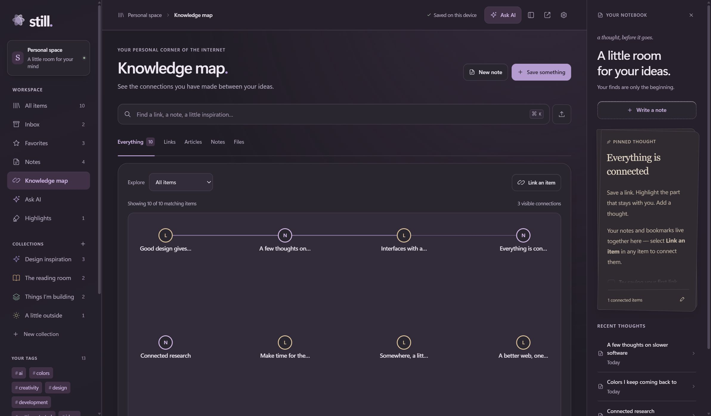

# Sidebar Dock · Still

**Version 0.4.0** — a local-first Chrome sidebar, new tab dashboard and full-tab workspace for bookmarks, articles, files, highlights and connected notes. Collect a source, think beside it, and bring the same context to your AI or coding agent.

Seven themes, from warm matte Still to Liquid Glass, with light/dark modes, soft edges and reduced-motion support keep the workspace calm. The sidebar, the new tab dashboard and full-tab views share one library. Opening the full workspace preserves the current view, space, filters and open item.




## Start using it

Local bookmarking and notes need no account, build step or dependency installation.

1. Open `chrome://extensions` in Chrome 120 or later and enable **Developer mode**.
2. Choose **Load unpacked** and select this repository's **`extension`** folder.
3. Pin **Still** and click its icon to open the sidebar. New tabs open your dashboard; **Open in a new tab** opens the full workspace.
4. Save a link, write a note, drop a file or use the page's right-click menu.

For an optional browser preview, use an existing **Node.js 22+** installation:

```powershell
node scripts/serve.mjs
```

Open [the local preview](http://127.0.0.1:4173/). Preview storage and extension storage are separate. Chrome capture, context menus, notifications and bookmark access require the loaded extension. See [installation and permissions](docs/INSTALL.md).

## New tab dashboard

New tabs open a dashboard of widgets on a 12-column grid, with a greeting, the date and the weather, and one search bar for the web, your library or the assistant. **Settings → New tab & dashboard** chooses the start page (Dashboard, All items, Inbox, Notes or the AI assistant), the search engine, the greeting and the wallpaper.

- **Boards:** several dashboards, switched from the header. **Edit layout** moves and resizes widgets with the pointer or the keyboard; narrow windows stack them in order. Each widget has its own settings, title and background (card, glass, flat or none).
- **Widgets:** Collection (a sidebar collection as link tiles; new ones go in a "Links folders" collection you can move or delete), Quick links, Notes, Checklist, Sticky notes, Kanban board, Clock, Weather, Calendar, Website, Most visited, Bookmarks, Product Hunt, GitHub and Linear. Library widgets show ordinary Still items, so their links, notes and tasks also appear in search, backups and AI context. Fetched data is cached so a new tab paints at once and refreshes in the background. Widgets that need Chrome access (top sites, bookmarks, a site's address) ask the first time.
- **Sticky notes:** notes that float over a board, move and resize freely, and gather on the **Sticky notes** corkboard. They stay ordinary notes in Notes, search, backups, the assistant and MCP clients. One switch shows or hides them on every board.
- **Wallpaper:** six presets, a color or your own image, with dim and blur, behind the dashboard or every page.

## Themes, full-screen assistant and settings

- **Themes:** Still, White, Liquid Glass, Midnight, Nord, Paper and Rosé recolor the sidebar, side panel, full tab and dashboard. Choose light, dark or system mode, one of seven accents, text size, density, corners, sidebar width, and reduced transparency or motion.
- **Organize tags with AI:** from the library menu or the command palette, the AI reads the library (or one collection) and your existing tags, proposes the fewest tags that keep things easy to find, and shows the plan for review before applying it, with Undo.
- **Full-screen assistant:** the **AI assistant** view gives a conversation the whole tab: a chats rail with search and history by day, a wide transcript with a docked composer, and a **Context & sources** rail with what the next question is about and the sources of the latest answer. The same chat moves between the side panel's Ask tab, the full-tab panel and this page. **Ask AI** in the dashboard search continues here.
- **Settings:** one searchable page (press `/`) with Appearance, New tab & dashboard, General, Library & backup, AI models, Assistant permissions, Browser automation, Research agent, Semantic search, Agents & MCP, Connected accounts, Integrations, Keyboard shortcuts, About and Help. In the side panel it opens as a panel with the same sections.

## Connected accounts

The GitHub, Linear and Paperclip widgets sign in from **Settings → Connected accounts** or from the widget. Credentials stay in this device's extension storage, apart from the library: never in backups, exports, widget settings, cached widget data or bridge sync. Chrome asks for optional access to the service's API when you connect.

| Service | Sign-in |
| --- | --- |
| GitHub | A personal access token (classic with `repo`, `read:org`, `workflow` and `notifications` for every feature, or fine-grained for chosen repositories); **Sign in** with GitHub's OAuth device flow and an OAuth app you own (paste its client ID; Still ships no client secret); or **GitHub CLI**, where the paired local bridge answers `GET /github/token` with `gh auth token` (or `GITHUB_TOKEN` / `GH_TOKEN` from its environment), only with the pairing token |
| Linear | A personal API key, checked with Linear before it is saved |
| Paperclip | Your Paperclip address (default `http://localhost:3100`) and no key in local trusted mode, or a board key (`pcp_board_…`) or agent key. Adds a tasks widget, **Send to Paperclip…** on saved items and read-only Paperclip tools for the assistant. See [Paperclip and Still](docs/paperclip.md) |

## One library, connected ideas

- **Mixed content:** bookmarks, captured article text, notes, images, videos and original files. Personal notes stay separate from saved source text.
- **Rich notes:** slash commands, headings, tasks, lists, callouts, quotes, code, dividers, inline formatting, editable tables, collapsible toggles and safe media/source links. Blocks, Markdown and Preview share a portable Markdown representation.
- **Subpages:** a note can live inside another note or inside any saved item, like a page inside a page. `/page` or **Add subpage** creates one and adds a page block (`[[id|Title]]{page}`) that shows its current title. Notes show their page path above the title and a **Subpages** section; the detail view of any item lists its subpages; **Move to page…** and **Move to top level** re-parent a note. Lists show top-level notes, with a chevron or count for subpages; search results include subpages with their path. Moving a page to Trash takes its subpages with it, restoring brings back the ones trashed together, and a page's collection carries down to its subpages. Pages nest at most 32 levels. Deleting a page block never deletes the page.
- **Import and embed:** `/import` turns PDF, Word, PowerPoint, Excel, Markdown, HTML, CSV, EPUB, RTF, text and image files into editable blocks, converted on this device, with an optional **Tidy with AI** pass by the provider's fast model at low effort. `/embed` shows live pages, YouTube/Vimeo/Loom videos, Figma, Google Docs and PDFs in a note, or an uploaded file from the library. See [import and embeds](docs/import-and-embeds.md).
- **Spaces:** Inbox for uncollected items; nested collections with descriptions, covers, colors, icons and pins. The icon picker offers about 600 icons in browsable groups, searchable by meaning ("money" finds wallets and coins). Overviews count notes, files/media and links/articles across descendants. Full-tab and sidebar layouts are independent, including per-space preferences.
- **Connections:** related items and computed backlinks let notes, articles and files support the same idea. The **Knowledge map** shows explicit saved links with scope/search/type filters, keyboard navigation and a clear 60-item display cap. Similarity does not create edges.
- **Organization:** tags, favorites, archive, recoverable Trash, reminders, bulk actions, drag-to-collection and grid/list/masonry views.
- **Search:** titles, URLs, descriptions, notes, captured text and highlights. Use `tag:design`, `#design`, `type:note`, `type:chat` or quoted phrases.
- **Capture:** right-click pages, links, images or selected text to save sources, highlights and connected notes. Choose visible-page or full-page screenshots; both retain source attribution.
- **Article capture:** **Save article** keeps a page's readable text as Markdown with its headings, lists, quotes, code, tables, images and video embeds, plus its site, author, publication date, language and icon. **Select parts** lets you click several parts of a page and saves them, in page order, as one article. Both are in the side panel (and its command palette) and in a page's right-click menu.
- **Research with AI:** a research agent reads a saved item, searches the web and GitHub, and writes a cited Research section and, when needed, subpages into it. See [Research with AI](#research-with-ai).
- **AI chats:** threads from [Threadkeeper](docs/threadkeeper-integration.md) (ChatGPT, Claude, Gemini, coding-agent sessions and more) become **Chat** items in your collections. See [AI chats](#ai-chats).

Full-page capture has progress, cancellation before saving, source-page restoration and an explicit result action. It is bounded to **16,384 pixels per axis, 48 megapixels, 50 viewport tiles and a 120-second capture deadline**. Oversized pages fail with guidance to choose visible capture. Protected pages, changing content, nested scroll containers and browser access restrictions can prevent capture.

`Ctrl/⌘ K` searches, `N` creates a note, `A` saves a link and `Ctrl/⌘ Enter` saves an edited note. Extension-wide shortcuts are in [INSTALL.md](docs/INSTALL.md).

### Article capture and Select parts

**Save article** (the side panel's **Save article**, the Add dialog's **Capture article**, or **Save article to Still** in a page's right-click menu) loads [Mozilla Readability](#third-party-code) and Still's own extractor into the page only when you ask. Readability picks the main content, and Still converts it to the Markdown its notes use. X posts, GitHub repositories and YouTube watch pages have their own readers. When Readability finds too little text, Still tries the page's single `article`, then `main`, then the body without navigation, footers and forms. In the side panel, a preview shows the page content with its word count, the name, icon, collection, tags and a note before you save. From the right-click menu the article saves at once; a page with no readable text is saved as an ordinary page. Saving a page that is already in your library refreshes its article text and fills empty details; its note, title, tags and collection stay as you left them. The page itself is only read, never changed.

**Select parts** (the side panel, or **Select parts of page…** in the right-click menu) starts a picker on the page. Hover and click parts to select them, use **−** and **+** on a selection (or ↓ and ↑ while hovering) to narrow or widen it, then choose **Done** or press Enter; Esc cancels. Selecting a part that contains another absorbs it. Up to 30 parts are saved as one article. From the side panel the result opens in the article preview; from the menu it saves to your default collection and Chrome shows a notification such as "Saved 3 selections from example.com". The picker draws its outlines in its own layer and never styles page elements.

The detail view shows a captured page's icon, site, author and publication date. Images in captured articles stay links to their source sites.

### AI chats

When Threadkeeper is connected (Settings › Integrations › AI chat threads), the threads you sync or add become library items of type **Chat**. Still keeps its own copy of each one (the summary and the transcript in this browser), so a chat stays readable and searchable when Threadkeeper is off, updating or uninstalled.

- **The chat page** looks like a note page, with two views. **Summary** shows Threadkeeper's analysis: what the thread is about, goal, outcome and status, key points, where you left off and the next step, decisions, next steps as tasks, open questions, what was produced, and context (topics, mentions, project, model, workspace and a resume command for Claude Code and Codex sessions). Small `m12` references jump to that message. Below it, **Your notes** is yours to edit, and the chat can hold subpages like any page. **Transcript** recreates the conversation: your messages in bubbles, answers as formatted text, tool calls folded into chips, long messages folded with **Show more**, 150 messages at a time from the end, and **Find in chat** (Enter and Shift+Enter step through matching messages). A long session Threadkeeper sent in part shows which messages are missing and loads them on request.
- **Where chats show:** the **Chats** view (full tab: list and page side by side, filtered by kind, provider and collection, with a search that also reads the stored summaries and transcripts), their collections, search results, `type:chat` and the map's **Chats** filter. Chats still where sync placed them stay out of All items and the Inbox; the **+N AI chats** chip brings them in.
- **Actions:** **Ask** about a chat, open the original conversation, **Open in Threadkeeper**, **Refresh from Threadkeeper**, **Improve** an older summary, copy the summary as Markdown, save it as a note inside the chat, copy the resume command, and move or trash it like any item. **Add chats** (the Chats view and the command palette) picks threads from Threadkeeper.
- **Safety:** thread text is treated as untrusted: it is never rendered as HTML, Markdown in it cannot create links into your library or embeds, and images named in a chat show as links instead of loading.

## AI and coding agents

The optional local companion handles provider credentials, streaming and coding-agent connections. It uses Node's built-in modules; **there are no npm packages to install**.

```powershell
node bridge/server.mjs
```

The first run creates `~/.still/bridge.json` (or `$STILL_HOME/bridge.json`) with a random pairing token. Keep it private. An existing `bridge/.local/config.json` from an earlier version is copied there on the bridge's first start and left in place. In Still → **Settings → AI models → Local bridge**, enter the loopback address and token, approve Chrome's optional loopback permission and keep a Still view open for sync. Starting the bridge does not configure or launch an AI client.

Open **Settings → AI models** to choose a connection:

| Connection | Supported paths |
| --- | --- |
| API providers | OpenAI Responses, Anthropic Messages, OpenRouter, Cloudflare Workers AI, AWS Bedrock ConverseStream and Google Gemini |
| Compatible/local endpoints | OpenAI-compatible and Anthropic-compatible APIs, Ollama and LM Studio |
| Coding agents | Codex CLI and Claude Code discovered on the bridge's PATH, using supported models and existing CLI authentication |
| Codex OAuth | Explicit **Sign in with ChatGPT** through Codex's official device-code/app-server flow; Codex owns its credentials |
| MCP clients | Claude Code, Codex, Claude Desktop, Cursor, VS Code, GitHub Copilot CLI, Gemini CLI and other compatible clients using the local bridge, plus agents in Paperclip |

Choose exact models and supported effort, temperature, image and context/output limits. Credentials for providers configured in the local companion are encrypted in its storage; an API key added directly in Still stays in this device's extension storage and never enters a backup. Provider tests and model discovery are explicit actions. Sending a prompt uses the selected provider or CLI. Still does not install coding agents or copy Codex account tokens.

The AI sidebar supports selected-item, current-space and relevant-library context, source citations, writing actions, streaming, cancellation, local conversation history and visible partial failures. **Ask about this space** includes its description and active nested content without broadening to other spaces. Responses can become connected notes or be explicitly inserted, appended or substituted into an unsaved draft. Retrieved content remains untrusted reference material.

### Assistant permissions

The assistant can also organize the library. It searches and reads items, then stages changes as a proposal card you apply or discard, with Undo afterwards. Changes cover new notes and subpages, saved links, collections, moves, tags, favorites, archive, Trash and restore, item edits, links between items and dashboard widgets. **Settings → Assistant permissions** chooses which kinds of change apply without review:

| Level | Create | Organize | Edit | Dashboard | Delete |
| --- | --- | --- | --- | --- | --- |
| Always ask (default) | Ask | Ask | Ask | Ask | Ask |
| Trusted | Allow | Allow | Allow | Allow | Ask |
| Full access | Allow | Allow | Allow | Allow | Allow |

**Custom** sets each kind separately. A step applies at once only when every change in it is of a kind you allow and it changes at most 50 items (subpages that move or go to Trash with a page count too); anything else, or anything this version cannot classify, waits on a card. Changes applied this way show as "Applied automatically" with Undo. One request can apply at most 12 steps automatically and propose at most 4 for review. The assistant's instructions and tool descriptions follow the setting, so it does not claim a change is waiting for you when it was applied. Permissions stay on this device: backups never include them and restoring a file never changes them. See [prompt contracts](docs/ai-prompts.md#assistant-permission-levels).

### Browser automation

The assistant can work in your browser: open tabs, read pages, click, type, scroll and fill in forms, signed in as you are. It uses the browser control layer of [Still Agent](https://github.com/andrewr303/still-agent), which observes a page as an outline of what can be acted on, sends real input once, and reports for every action whether the input was dispatched, whether the page reacted and whether the expected state was reached.

It is off until you turn it on in **Settings → Browser automation**, which is also when Chrome asks for access to your tabs. You decide how much it may change on its own:

| Step | Ask first (default) | Auto |
| --- | --- | --- |
| Reading, scrolling, moving between pages and tabs | Runs | Runs |
| Sending a form, posting, deleting | Waits on a card for **Allow** or **Don't allow** | Runs, except on sites you set to Ask |
| Paying, granting access to an account, typing a password, card number or code, answering a page's prompt | Yours to do, in every mode | Yours to do, in every mode |

A rule per site can always allow changes there, always ask, or keep the assistant off the site. Text from pages reaches the model marked as data, never as instructions, and once a request has read a page, any change it proposes to your library waits for your review whatever **Assistant permissions** allow. Steps the assistant could not confirm are listed under its answer. Chrome shows its debugging bar while the assistant is attached to a tab, and lists "Access the page debugger backend" and "Read and change all your data on all websites" among Still's permissions. See [Browser automation and the assistant's engine](docs/browser-automation.md).

### Web search and long sources

- **Web search:** with **Settings → AI models → Let the assistant search the web** (off by default) and an Anthropic or OpenAI API key added in Still, the model's provider searches the web for an answer. The answer links what it used, the pages are listed under **From the web**, and the provider bills the searches to your key. With browser automation on, any model with tool support can also look things up by reading a search engine's results in a new tab.
- **Long sources:** a long note, article or page reaches the model as its opening plus the passages that match your question, not only its first few thousand characters, and the assistant can read on from any passage. A follow-up such as "and the second one?" is searched together with the question before it.
- **Context window:** the assistant sizes each request for the model in use (asking Ollama and LM Studio what window they loaded), folds older steps of a long request into notes before the window fills, and tries a busy provider again before it gives up.

### Research with AI

**Research with AI** researches one saved item as a [Claude Managed Agents](https://platform.claude.com/docs/en/managed-agents/overview) session in your own Anthropic account, with Claude Sonnet 5.5. It needs an Anthropic API key added in **Settings → AI models** (keys used through the local bridge, Claude Code, Codex or a compatible endpoint cannot run it) and one-time Chrome access to `api.anthropic.com`. The agent uses web search, web fetch and read-only GitHub tools. It writes, through Still's own tools, only a dated **Research** section with source links on that item and the subpages it creates. It does not read your other items, does not change your text or the original unless you turn that on, and never deletes anything. The assistant shows its progress, cost and controls: Stop, Resume, Raise cap and continue, and Undo research changes (removes the section, moves the subpages to Trash). Each run has a spending cap, $5 by default, billed to your Anthropic account. **Settings → Research agent** sets depth, GitHub use, subpages per run, the cap and whether the original may be edited; these settings stay on this device. See [Research with AI](docs/research-agent.md).

### MCP and coding agents

The MCP server exposes **33 tools** to read and update notes, saved article text, highlights, relationships, collection metadata, tags and item state, plus paginated exports and bounded original-file reads. Subpages are notes with a `parentId`: `create_item` accepts one, `list_items` and `search_library` filter by it, `get_item` lists `subpageIds`, and `move_page` moves a note inside another item or back to the top level. Mutations return a queued receipt; clients must check `get_operation` for `saved` or `failed`. Revision checks reject stale edits. File reads return at most 65,536 bytes per chunk and never accept arbitrary filesystem paths. Each tool is annotated as read (14), write (13) or destructive (6), and items, collections and searches are also offered as MCP resources, with five prompts such as `research` and `task_context`.

**Settings → Agents & MCP** and `npm run connect -- <client>` offer reviewable setup for 13 clients, snippets for 5 more, and installation of the included [Still workspace agent skill](agent-skills/still-workspace/SKILL.md). Configuration and skill installation require an explicit action and return receipts. Claude Code can also install Still as a plugin: `/plugin marketplace add AVRCORP/sidebar-dock`, then `/plugin install still@still-plugins`. Keep a syncing Still view open while a client uses the library.

**Paperclip** agents reach Still over the bridge's HTTP endpoint with their own token, limited to read-only, everyday or full access. `npm run connect -- paperclip` (or **Connect Paperclip** in Settings) prints the config to paste into Paperclip. Paperclip must run on this computer or your private network. See [Paperclip and Still](docs/paperclip.md).

- [Providers and local endpoints](docs/ai-providers.md)
- [CLI agents and official Codex sign-in](docs/ai-cli.md)
- [MCP clients and agent skills](docs/mcp-agents.md)
- [Paperclip and Still](docs/paperclip.md)
- [Context and prompt contracts](docs/ai-prompts.md)
- [Browser automation and the assistant's engine](docs/browser-automation.md)
- [Research with AI](docs/research-agent.md)
- [Raindrop, GitHub and other integrations](docs/integrations.md)

Raindrop import uses your personal token to bring in collections, links, notes and highlights. Selected URL items can be sent back explicitly. Raindrop's remote MCP server is a separate data source. Notion, Readwise, Zapier, Make, n8n and RSS cards link to official guides; Drive and Dropbox are manual backup destinations.

## Data ownership and portability

Library metadata stays in `chrome.storage.local`; original file bytes stay in IndexedDB. Uploads are bounded to **100 MB per file** and portable imports to **200 MB per backup**, subject to available device storage.

**Settings & backup → Full backup** exports sources, personal notes, subpages, captured page details, highlights, connections, nested collection metadata, original file bytes, the wallpaper, dashboards, assistant chats (research conversations included) and AI settings (never API keys, account tokens or other credentials, and never the device-only assistant permissions and research agent settings). Import validates the whole file before writing, takes an automatic snapshot first, and rolls back newly written attachments if a later stage fails. Records merge by ID and the newer copy wins, so newer edits on this device are kept and items deleted forever are not brought back; non-secret preferences come back, device credentials stay local. A legacy metadata-only backup cannot restore bytes it never contained.

Still also keeps **automatic snapshots** on this device (after an update, daily when something changed, and before every import or restore); Settings lists them and restores any of them, taking a safety snapshot first. Snapshots are deleted with the extension's data, so keep a downloaded full backup elsewhere. See [docs/data-model.md](docs/data-model.md).

HTML bookmark import/export preserves nested folders. CSV import and export support quoted multiline fields, notes, tags, descriptions, type, collection, dates, site, author, published date and language; CSV has no item IDs, so subpages come back as top-level notes. Markdown export retains personal notes, annotations and source connections, puts each subpage after its parent page and turns page blocks into links, and assistant chats export as Markdown too. Existing Chrome bookmarks can be imported after granting optional access.

## References and provenance

All **29 supplied reference images** are packaged in **Help → The reference room**, with captions. The [reference catalogue and Fabric expansion notes](docs/fabric-expansion.md) distinguish read-only browser observations and bounded static findings from functionality implemented here.

Original third-party packages, private account observations, copied source and decompiler artifacts are excluded from publication. Static recovery is partial; Sidebar Dock does not claim complete Fabric reconstruction, source-format compatibility or feature parity.

### Third-party code

Still ships two pieces of third-party code. The first is [Mozilla Readability](https://github.com/mozilla/readability)'s `Readability.js`, licensed under the Apache License 2.0, as [`extension/lib/vendor/readability.js`](extension/lib/vendor/readability.js). It is pinned to upstream commit `ab4027a8b37669745016869a37a504727992b2ba` and kept byte for byte unmodified (90,944 bytes, SHA-256 `e9330028c8a5a4aa7d75147be2605d520f7f213c7b28474947dc0e9c984e9bed`). [`extension/assets/licenses/readability.txt`](extension/assets/licenses/readability.txt) records that provenance with the upstream NOTICE and the full license text. `scripts/check.mjs` and both packaging scripts refuse a changed copy (the pins are in [`scripts/vendored.mjs`](scripts/vendored.mjs)). 
The second is the browser control layer of [Still Agent](https://github.com/andrewr303/still-agent), licensed under the Apache License 2.0. Its source is in [`browser-control/src`](browser-control/src), copied without changes from Still Agent commit `5b4d161f99ba91c94651e6eac78e73ae1d4222ea`, and it is built into [`extension/lib/browser-control/layer.js`](extension/lib/browser-control/layer.js) together with `puppeteer-core` 25.16.0 (Apache-2.0), `ws` 8.22.2 (MIT) and `zod` 4.6.7 (MIT). [`extension/assets/licenses/browser-control.txt`](extension/assets/licenses/browser-control.txt) holds their notices and licence texts. The built files are committed with their sizes and SHA-256 hashes in [`scripts/generated.json`](scripts/generated.json), and `scripts/check.mjs` refuses a built file that does not match its source. See [`browser-control/README.md`](browser-control/README.md).

Everything else, including the article-to-Markdown converter, the X, GitHub and YouTube readers and the page picker, is original code.

Raindrop's [help centre](https://help.raindrop.io/), [Claude guide](https://help.raindrop.io/integrations/claude) and [integration directory](https://help.raindrop.io/integrations) also informed the library and connection flows.

## Validation and current limits

From Node.js 22+:

```powershell
node --test tests/*.test.mjs
node scripts/check.mjs
node scripts/package.mjs
node scripts/package-runtime.mjs
npm run layer:test
node scripts/e2e-browser.mjs
```

The last two are for browser automation. `npm run layer:test` runs the browser control layer's own tests and needs `npm ci` in `browser-control` first. `node scripts/e2e-browser.mjs` loads the extension in headless Chrome for Testing or Chromium (set `CHROME_PATH` to choose one; branded Chrome no longer loads an unpacked extension from the command line) and drives the assistant against local pages with a scripted model; it uses a temporary profile and the mock keychain.

The current local suite contains **1,741 tests** covering storage/revisions, dashboard layout and backup, widget data, themes, sticky notes, rich-note round trips, nested space boundaries, explicit graph links, capture planning/cancellation/cleanup, binary backup restoration, rejected imports, file conversion against real PDF/Office/EPUB fixtures, AI import fallbacks, embed round trips, provider transports, official CLI login protocol handling and authenticated MCP mutation receipts. Newer tests cover article extraction and the Markdown converter on a small test DOM, the page picker, article capture through the worker, subpage cascades, imports and MCP tools, assistant permission levels, the research engine against a local fake Managed Agents server, MCP protocol edge cases, scoped tokens, the per-user bridge config, the newer client setups, and both Paperclip directions against fakes. Tests for browser automation cover the service worker's host against a fake layer, the port client, the tools with their cards, ledger and loop guards, context management, retries, passages and retrieval, the web search transports against recorded streams, and the Settings section and cards. On the latest run (Linux, Node 22.23), **1,740 passed and 1 failed**. The failure is `AI writes take the still.ai.v2 Web Lock` in `tests/storage-stores.test.mjs`, which needs `navigator.locks`; that Node runtime doesn't provide it, and it failed the same way before these changes. Earlier, on a macOS development machine, 12 tests in `tests/ai-cli.test.mjs` failed because temporary folders resolve through `/private/var`; results depend on the machine. Static checks validate imports, assets, manifest/CSP, reference images, injected page scripts, the vendored file's pin and that the built browser control layer matches its source. Packaging checks validate ZIP entrypoints and integrity. The layer's own suite has 318 tests, all passing, and the real-browser run has 11 scenarios, all passing in headless Chrome for Testing: the host protocol, adding to a cart, a contact form in Ask mode (allowed and declined) and in Auto mode, a lookup through a results page, a page that tries to give orders, a hand-over, a click without effect, a blocked site, and automation switched off.

BrowserOS neo checks exercised table/toggle editing and persistence, space metadata/layout persistence, a locally mocked space-cited AI answer, separate conversations when changing spaces, keyboard map navigation, wide/narrow layouts and dark mode. Screenshots above show the actual isolated preview; no paid model request was made. Reduced-motion styles were checked; animation frame rate was not measured.

Installed-extension activation of native capture, context menus, side-panel APIs and notifications still needs real-browser verification. Article capture, Select parts, subpages and Research with AI were tested only with stubbed Chrome APIs and a test DOM, not in a loaded extension, and no live Managed Agents session was run. Account-backed OAuth completion, live Raindrop access, paid inference, provider entitlement and actual Claude/Codex client activation have not been established by local fixtures. Those tests do not establish model answer quality. Browser automation was run in a loaded extension only with a scripted model and local pages: no real model chose the steps, no provider's web search was called, and real sites, sign-in walls and CAPTCHAs were not tried. The permission prompt of a store-installed update was not observed.

There is no cross-device cloud sync, hosted collaboration, automatic page-annotation reattachment, video transcription or text extraction from saved PDF/EPUB files (use `/import` in a note to turn one into text). Those files can still be stored, downloaded, tagged, embedded and connected to notes. Sites that refuse framing cannot be embedded; their embeds keep an Open link. Remote covers load from their source sites. The MCP bridge shares with configured local clients while enabled; an external AI provider receives the context selected for that request.

**Article capture limits.** Capture needs access to the page: the right-click menu has it for that tab, and the side panel asks Chrome for access to the site when it lacks it. Browser pages, the Chrome Web Store and PDF, image or video documents cannot be read. Only the top-level document is read: content inside frames is not, so embedded posts and widgets are missing; a recognized YouTube, Vimeo, Loom or X player becomes an embed line and another titled frame a link. Readability can drop parts it judges to be clutter, such as comment sections or short sharing sections, and on unusual layouts it can keep clutter or miss an intro. Content that has not loaded yet (for example on scroll) is not captured. Captured text is cut at 250,000 characters on a block boundary, with at most 50 images and 2,000 table rows; pages over 30,000 elements skip Readability, and a conversion stops after about 4 seconds. Images are not downloaded.

**Select parts limits.** The picker runs only in the top-level page. It cannot select inside frames, and cross-origin frames cannot be read at all: a whole frame can be selected and becomes an embed line or link like above. While picking, page hover styles and cursors over frames do not show, and wheel scrolling over a frame scrolls the page around it, not the frame's own content. Frames inside open shadow roots are not covered and still receive clicks. Up to 30 parts per selection.

**Browser automation limits.** Chrome and Edge only, in the loaded extension. Browser pages, the Chrome Web Store and other extensions' pages cannot be controlled. The assistant cannot upload files, save downloads or read PDF documents in the browser's viewer. Detecting that a step sends, deletes or pays is best effort: a control the layer does not recognise as one runs as a plain click. Reading and moving never ask, so a model that was fooled by a page could still put text into a search box or an address; site rules and Ask mode limit that, and the instructions forbid it, but nothing structural prevents it. Web search needs an Anthropic or OpenAI key added in Still; Gemini's search grounding is not wired in. See [the full list](docs/browser-automation.md#limits).

**Subpage limits.** Only notes can be subpages. Archiving a page does not archive its subpages. Siblings are ordered by creation time; there is no manual order. CSV exports and imports subpages as flat rows.

**Research limits.** Research needs an Anthropic API key added in Still and one-time access to `api.anthropic.com`, and cannot run in the localhost preview. Each run is a Managed Agents session stored in your Anthropic account and billed there; Still never deletes those sessions. The model is fixed to Claude Sonnet 5.5. The run makes progress only while the Still page that started it (or one that resumed it) is open. The agent cannot read your other saved items. The right-click **Save and research with AI** entry stays visible when research is turned off; it then saves the page and the side panel says research is off. If the side panel does not answer within about 2 seconds, the saved item opens in a Still tab and research does not start.
